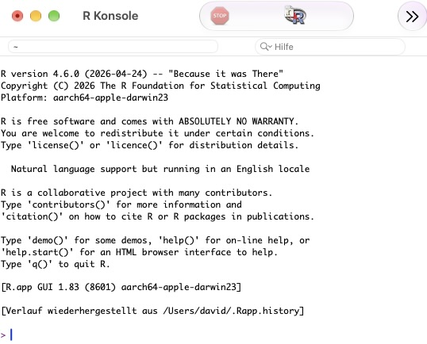
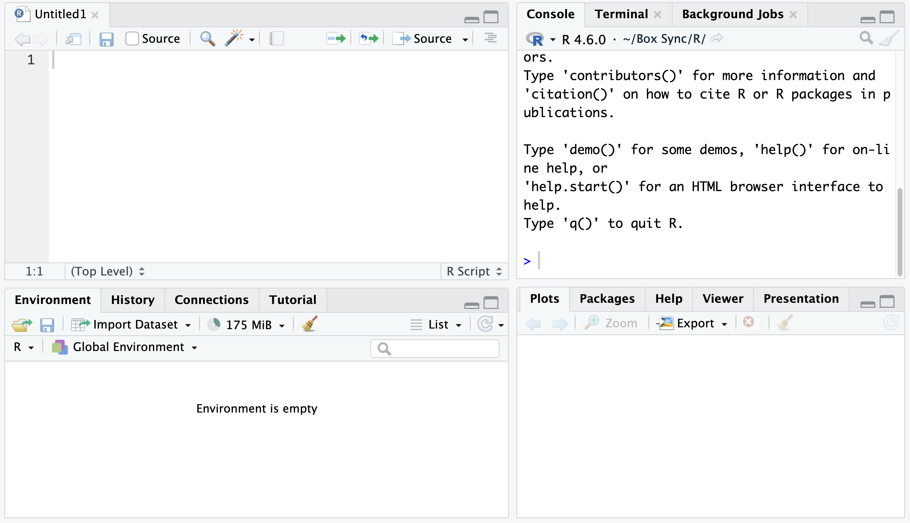
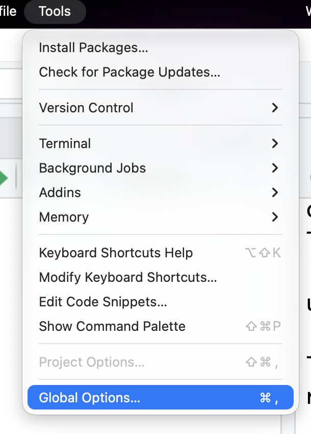
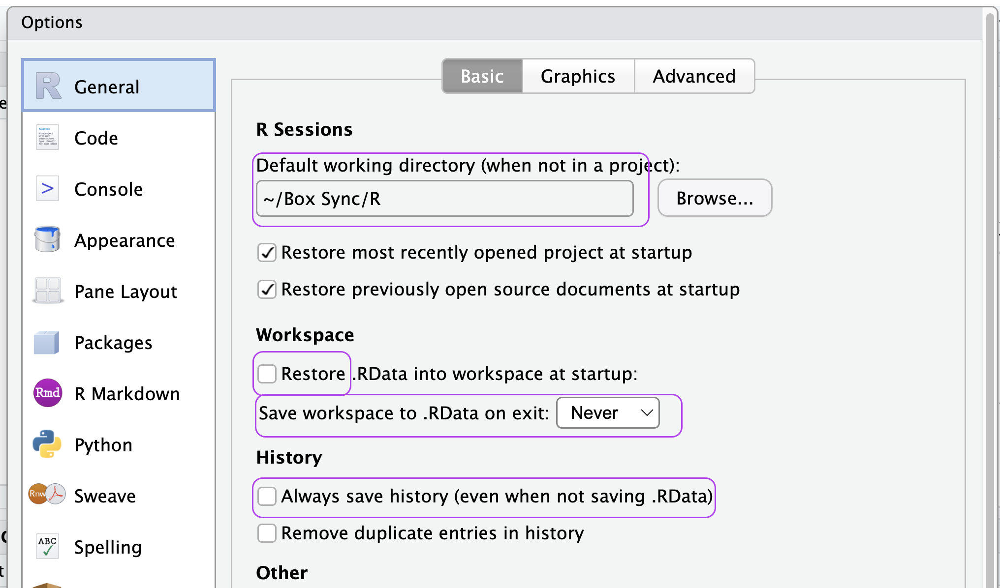
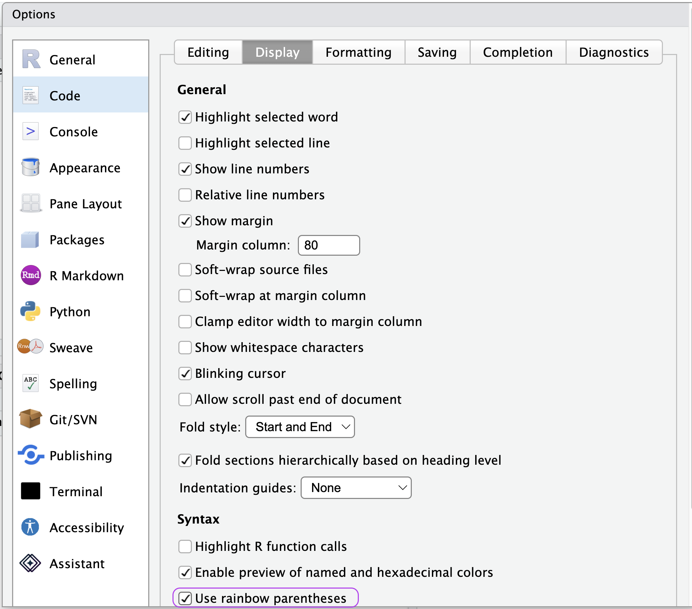
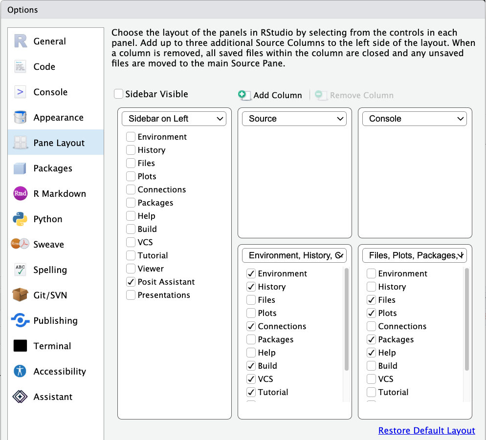
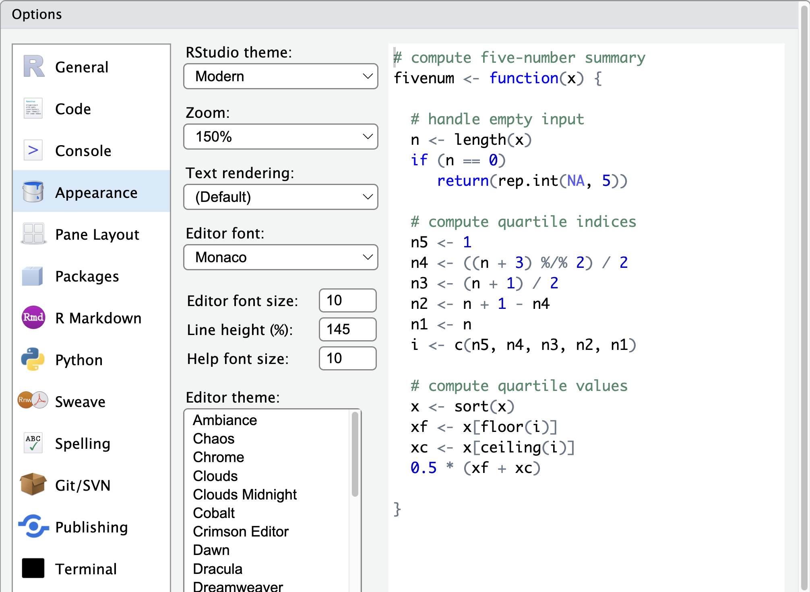
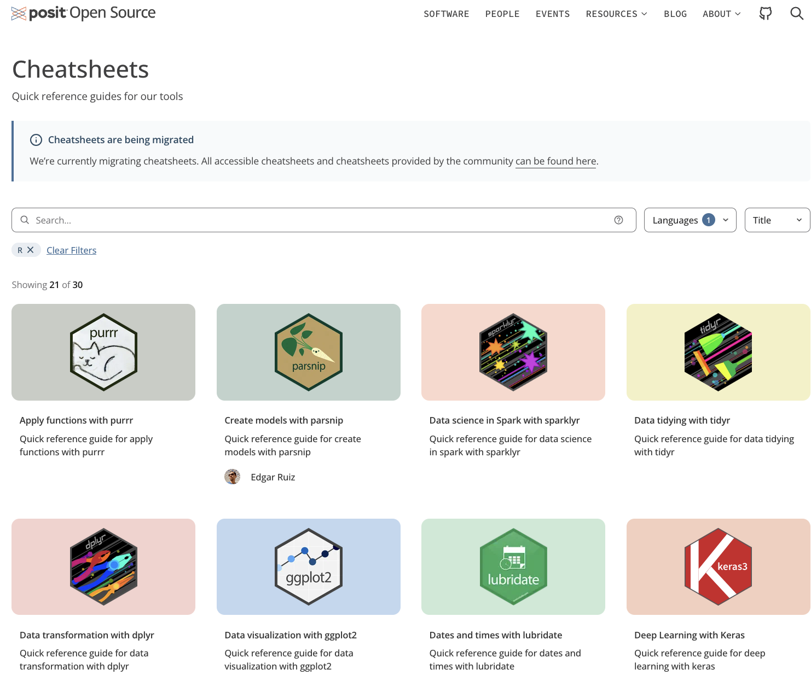
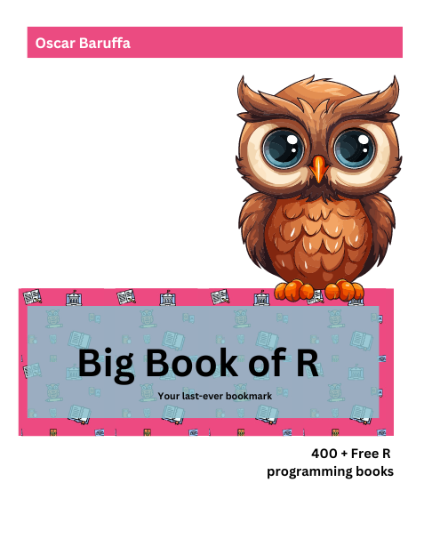
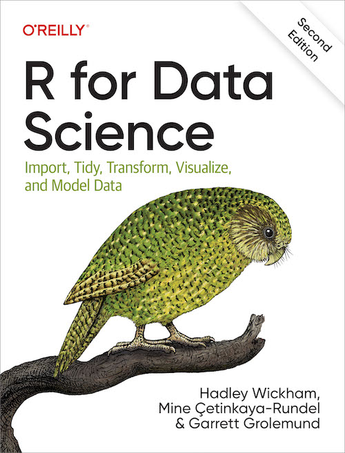

```{r}
#| eval: true
#| echo: false
options(repos = c(CRAN = "https://cloud.r-project.org"))
CRANpackages <- available.packages()
nrp <- nrow(CRANpackages)
```

## Agenda

-   Warum {.logo}?
-   Wo bekomme ich {.logo} her?
-   Wie funktioniert der Spass?
-   Good Practices
-   Wo bekomme ich Hilfe?
-   Fragen?

# Warum {height=1em} ?

## Warum *R*?

[Ich möchte doch nur einfach Analysen rechnen, reicht da nicht Excel?]{.bat-bubble .inverse .right}
[Grundsätzlich ja, aber es gibt 10 gute Gründe {.logo}zu lerenen.]{.bat-bubble .align-right .left}


## 10 Gründe *R* zu lernen

{.logo} kann über verschiedene Plattformen hinweg genutzt werden \
{.logo} ist ein Sprache von Statistiker\*innen für Statistiker\*innen \
{.logo} wird in der Praxis immer stärker nachgefragt \
{.logo} hat eine riesige und hilfsbereite Community \
{.logo} großartige Möglichkeiten zur Visualisierung \
{.logo} unzählige Erweiterungsmöglichkeiten  \
{.logo} wird in großen Firmen genutzt   \
{.logo} hilft dabei Geld zu verdienen \
{.logo} kann interaktive Web-Apps   \
{.logo} ist open source 


# Wie bekomme ich {.logo}?

## Wo bekomme ich *R* überhaupt her?

1. {.logo} [herunterladen](https://cran.r-project.org/)
2. {.logo} installieren
3. Prüfen ob {.logo} läuft


::: {.fragment}
::: {.callout}
CRAN steht für *Comprehensive R Archive Network*
:::
:::

## Wenn es funktioniert, dann ...


:::: {.columns}

::: {.column width="60%"}
{fig-align="center"}
:::

::: {.column width="40%"}
[Das sieht hervorragend aus!]{.bat-bubble .inverse }
:::

::::


## R-Studio macht alles erträglicher

1. {.logo} [herunterladen](https://posit.co/downloads)
2. {.logo} installieren
3. Prüfen ob {.logo} läuft


::: {.fragment}
::: {.callout}
{.logo} ist ein Editor für {.logo}.
:::
:::

## So sieht R-Studio aus

{fig-align="center"}


# Wie funktioniert der Spass?

## Wo finde ich was ich brauche?

- Console
- Script
- Environment
- Files/Plots/Packages/Help/Viewer

## Ein paar Dinge müssen wir konfigurieren

:::: {.columns}

::: {.column width="33%"}

:::

::: {.column width="33%"}

:::

::: {.column width="33%"}

:::

::::


## Ein paar Dinge können wir konfigurieren

:::: {.columns}

::: {.column width="50%"}

:::

::: {.column width="50%"}

:::

::::


## Console

-   Hier könn(t)en wir alles erledigen
-   beim Start gibt es eine Versionsinfo
-   `>` „der Prompt" = Eingabeaufforderung
-   hinter dem Prompt kann „gearbeitet" werden, z.B. `1 - 8`
-   mit „Enter" wird der Befehl ausgeführt

## Console - Ausgabe

Ausgabe beginnt mit `[1]`

-   hat nichts mit dem Ergebnis zu tun,
-   sondern nummeriert die Ergebnisse

Sehen wir:

-   `>` alles gut!
-   `+` läuft noch ein Befehl

## Console - Aufräumen

-   Nach vielen Rechnungen wird die Console schnell unübersichtlich
-   Console enthält alle Befehle (inkl. Warn- und Fehlermeldung)

Aufräumen mit

Shortcut: "CMD" / "Strg" + "L"

## Script - Erstellen und Ausführen

-   File → New File → *R*-Script
-   Im Script können Befehle eingegeben werden
-   Cursor „in den Befehl setzen"
-   "CMD" / "Strg" + "Enter"
-   oder: Button *Run* in der Script-Leiste

## Script - Speichern

-   File → Save
-   oder: "CMD" / "Strg" + "s"
-   oder: File → Save As…
-   Scripte werden wiederverwendbar bzw. sind einfach zu modifizieren
-   Frage nach *Encoding* (Sonderzeichen) → einmalig

## Environment

-   Es werden alle Objekte angezeigt
-   *History*: alle Befehle (chronologisch)
-   *Connections*: Verbindungen

## Files/Plots/Packages/Help/Viewer

-   *Files*: Explorer/Finder
-   *Plots*: Abbildungen
-   *Packages*: Liste der installierten Pakete
-   *Help*: Hilfe
-   *Viewer*: …

## Packages

-   {.logo}bringt viele Funktionen mit, die genutzt werden können
-   Grundfunktionen können mit Packages erweitert werden
-   Für (fast) alles gibt es ein Package 
-   Es gibt ca. `{r} nrp` Packages

## Wie bekomme ich nun diese Packages?

- direkt im Script
- über das Menü: *Tools → Install Packages …*
- im Packges-Fenster

::: {.fragment}
::: {.callout-important}

Informationen nach dem Laden erscheinen in der Console<br>

Manchmal kann es auch zu "Konflikten" zwischen Packages kommen! 
:::

[Warum?!]{.bat-bubble .align-right .left .inverse}

:::


## Wie nutze ich diese Packages nun?

| Einmal | Bei jedem Neustart |
|:---------------------------|:---------------------------|
| `install.packages("package.name")` | `library("package.name")` |

## Packages - Merkhilfe


:::: {.columns}

::: {.column width="50%"}

:::

::: {.column width="50%"}

:::

::::


::: {.callout}
*R* ist „case sensitive" darum Achtung bei der Groß- und Kleinschreibung!
:::

## Was passiert, wenn *R* nicht „aktuell" ist?

-   bei „kleineren Sprüngen" (4.5.0 auf 4.5.1) gibt es keine Probleme
-   bei größeren sollten Sie {.logo} (inklusive Packages) updaten

# Fragen?

# Good Practices

## Good Practices - Dateinamen

-   keine kryptischen, sondern eindeutige Namen\
    Nicht: „auswertung132bmg.R" → „coda_ue01_v01.R"
-   kurze Namen → nutzen Sie immer dieselben Abkürzungen\
    z.B. „coda" für computerunterstützte Datenauswertung
-   keine Sonderzeichen
-   nutzen Sie sequentielle Nummerierung\
    → 01, 02, … statt 1, 2, …

## Good Practices - Syntax

-   Objektnamen
-   Spacing
-   Einrückungen
-   Lange Zeilen
-   Kommentare

## Syntax - Objektnamen

:::: {.columns}

::: {.column width="50%"}
Gut
```{r}
#| eval: false
#| echo: true
objekt_01
tag_01
```

:::

::: {.column width="50%"}
Schlecht
```{r}
#| eval: false
#| echo: true
Objekt1
Tagttes
```

:::

::::

## Syntax - Spacing

:::: {.columns}

::: {.column width="50%"}
Gut
```{r}
#| eval: false
#| echo: true
x <- data.frame(x = 1:10, y = 10:1)

x[, 1]


mean(x, na.rm = TRUE)


age_r <- (second / 3600) + 12
```
:::

::: {.column width="50%"}
Schlecht
```{r}
#| eval: false
#| echo: true
x<-data.frame(x=1:10,y=10:1)

x[,1]
x[ ,1]

mean (x, na.rm = TRUE)
mean( x, na.rm = TRUE )

age_r<-(second/3600)+12
```
:::

::::


## Syntax - Einrückungen

Ohne Einrückungen und Leerzeichen wird Code kaum lesbar

```{r}
#| eval: false
#| echo: true
ds|>
select(id,starts_with("er"),-er_mean)|>
pivot_longer(-id)|>
ggplot(aes(y=value,x=""))+
position=position_jitter(width=-.9,side="l",size=.5,alpha=0.8)
```

## Syntax - Lange Zeilen

Lange Zeilen umbrechen, damit der gesamte Code ohne Scrollen sichtbar ist

```{r}
#| eval: false
#| echo: true
ds |>
  select(
    id,
    starts_with("er"),
    -er_mean) |>
  pivot_longer(-id) |>
  ggplot(
    aes(
        y = value,
         x = "")
)
```

## Syntax - Kommentare #

[Wie soll ich nach einem halben Jahr noch wissen,<br>was das alles bedeutet?]{.bat-bubble .inverse .right}

```{r}
#| eval: false
#| echo: true
ds |> # Name des verwendeten Datensatzes
  select(id,
         starts_with("er"),    # verwende die folgenden Spalten
         -er_mean) |>          # lass die Spalte "er_mean" weg
  pivot_longer(-id) |>         # Restrukturierung des Datensatzes
  ggplot(aes(y = value,        # Produziere einen Plot
             x = "")) +
  ...
```


# Wo bekomme ich Hilfe?

## Wo bekomme ich Hilfe?

-   Direkt in R-Studio
-   Social Media
-   Cheatsheets
-   Bücher
-   Foren
-   KI

## Direkt in R-Studio

```{r}
#| eval: false
#| echo: true
?mean          # Hilfeseite zu einer Funktion
help("mean")   # gleichbedeutend
```

oder Reiter *Help* im Fenster „Files/Plots/Packages/Help/Viewer"

## Cheatsheets

{fig-align="center"}


## Bücher

{fig-align="center"}

## Meine Empfehlung

{fig-align="center"}


## Hier ein paar nützliche Links

-   [R for the Rest of Us](https://rfortherestofus.com) 
-   [R for Data Science](https://r4ds.hadley.nz/)
-   [R-Suchmaschine](https://rseek.org)
-   [Big Book of R](https://www.bigbookofr.com)
-   [Stackoverflow](https://stackoverflow.com)
-   [Cheatsheets](https://opensource.posit.co/resources/cheatsheets)

# Fragen?
